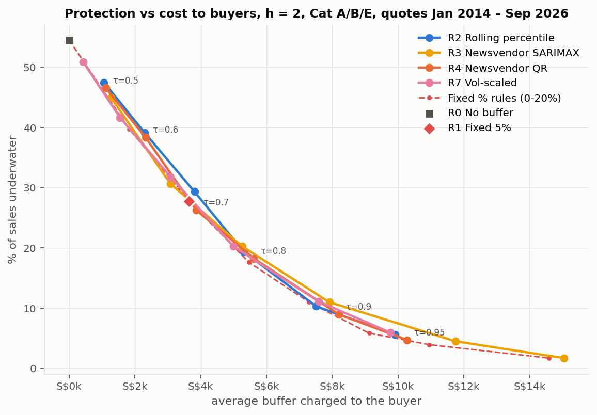

## 1. Problem and framing

Singapore car dealers sell "guaranteed COE" packages. The car price is fixed using the latest Certificate of Entitlement (COE) premium. The dealer then secures the COE in a later bidding round, whatever it costs, and any rise in between comes out of the dealer's margin. A dealer that quoted at the latest premium and bid two rounds (about a month) later was **underwater on 64% of Cat A and Cat B sales since 2023**, losing on average S$4,920 (A) and S$6,180 (B) per underwater car. In January 2024 alone, Cat B jumped S$26,990 in one round. Dealers today use no buffer or a flat 5%.

**Research question:** how large a COE buffer should a dealer add to a guaranteed package so that it rarely loses money without overpricing the car?

**Newsvendor framing.** The buffer *b* is the order quantity and the premium rise *R* is the uncertain demand.

- Underpricing (*R* > *b*) costs *c_u* = S$1 per S$1 short.
- Overpricing (*b* > *R*) costs *c_o* in lost or discounted sales.
- The optimal buffer is $b^* = F_R^{-1}(\tau^*)$ with $\tau^* = k/(1+k)$ and $k = c_u/c_o$.

*c_o* is private, so we report buffers for k = 1–19 (τ = 0.5–0.95).

## 2. Data and features

- **Prices.** LTA *COE Bidding Results* (data.gov.sg): 398 rounds, January 2010 – October 2026, frozen at October 2026 round 2. We use the car categories A, B and E (1,194 rows). The only gap is the April–June 2020 suspension, and targets spanning it are dropped.
- **Policy events.** We added 14 events by hand (quota injections, loan rules, EV-rebate changes, category redefinitions), each with its source, announcement date and expected direction.
- **Target.** The 2-round rise $r_{t} = P_{t+2}/P_t - 1$. It is modelled in % because premiums rose 6.9× since 2010, and converted to S$ at the quote.
- **Features.** Every feature uses only information available at round *t*: bid ratio, momentum, 12-round and EWMA volatility (λ = 0.94), quota changes LTA had already announced, and policy events announced before *t*. An automated test rebuilds the features on a truncated panel and confirms none changes.

**EDA.** Three facts drive the design:

- **Direction is unpredictable.** The bid ratio's correlation with the next rise is about 0, and 1-round changes have almost no momentum.
- **Volatility clusters.** The lag-1 autocorrelation of absolute changes is 0.33 in Cat B.
- **Dollar risk has not fallen.** In % terms rises are narrower than in 2010–14 (90th percentile +15.5% → +9.0%), but in S$ the 90th percentile rose from S$8,631 to S$9,161, because premiums are far higher.

## 3. Methods

**Driver regression.** OLS of the 2-round rise with Newey–West standard errors (2 lags, since 2-round targets overlap), VIF screening (VIF > 5 removed), and a post-May-2022 stability test.

**Forecast models.** Each model gives quantiles at τ = 0.5, 0.6, …, 0.95:

| | Model | | Model |
|----|------------------------------------|----|------------------------------------|
| M0 | Naive, rise = 0 (no buffer) | M4 | Gradient boosting, quantile loss |
| M1 | Rolling percentile of last 48 realised rises | M5 | Average of M1 and M3 |
| M2 | SARIMAX, 2,000 simulated paths | M6 | **Volatility-scaled:** $q_\tau = z_\tau \times$ EWMA volatility |
| M3 | Pooled quantile regression on the features | M7 | M1 + adaptive (online) calibration |

**Evaluation.**

- **Rolling origin** from January 2014: models train only on rises already realised and are refit every 4 rounds.
- **Scoring:** pinball loss (the newsvendor cost scaled by 1/(c_u + c_o)) and calibration.
- **Model choice:** the buffer model is chosen by a rule fixed in advance, **lowest pinball loss on the 2014–19 validation period**. 2020–26 is the test period.
- **Significance:** Diebold–Mariano tests with HAC errors.

**Backtest.**

- One simulated sale per category per round: 894 quotes, January 2014 – September 2026.
- Rules: R0 no buffer, R1 fixed 5%, and newsvendor rules from each model (R2 = M1, R3 = M2, R4 = M3, R7 = M6, R8 = M7).
- Cost per car = shortfall + excess/*k*.
- Confidence intervals from a moving-block bootstrap (8-round blocks, 1,000 resamples).
- Robustness checks:
  - M1 window of 24–96 rounds;
  - refit frequency;
  - 16 M6 designs;
  - adaptive-calibration step sizes;
  - Kupiec coverage and Christoffersen clustering tests on non-overlapping paths, with Bonferroni correction.

## 4. Results

**4.1 Drivers.** The features explain almost nothing: **R² = 0.018**.

- Announced price-lowering events (injections, loan curbs, rebate cuts) come with a 4.3-point lower rise (about S$5,680 on Cat B; p = 0.003). Only 12 rows carry the flag.
- Mild mean reversion: −0.8 points after a 1-s.d. larger 2-round rise (p = 0.03).
- The bid ratio is not significant (p = 0.19).
- The effects shifted after May 2022 (Wald p = 0.028).

A buffer cannot be tuned on bid pressure; only the *size* of swings is predictable.

**4.2 Forecasts.** Mean pinball loss (S$, h = 2):

| Period | M0 | M1 | M2 | M3 | M4 | M5 | M6 | M7 |
|---|---|---|---|---|---|---|---|---|
| Validation 2014–19 | 1,474 | 1,208 | 1,421 | 1,235 | 1,228 | 1,210 | **1,188** | 1,218 |
| Test 2020–26 | 3,029 | 1,917 | 2,063 | 1,927 | 1,908 | **1,901** | 1,929 | 1,951 |

**Model choice.** Every model beats no buffer, by 23–31%. By the pre-set rule the buffer model is **M6**, but its 1.7% validation lead does not survive on the test period.

**Diebold–Mariano tests:**

- **Tied with M1:** M3, M4, M5 and M6 (p = 0.41–0.91).
- **Significantly worse:** SARIMAX (+10%, p < 0.001), whose ranges are too wide (89% coverage at τ = 0.8), and adaptive calibration (M7: +1.4%, p = 0.001). M7 cuts the 2020–22 coverage error from 2.6 to 0.4 points but raises the cost. **Calibration and cost are different targets.**

**4.3 What today's rules assume.**

- **No buffer** covered 46% of sales, so it behaves as if **k = 0.84**: overpricing is treated as the bigger risk.
- **Fixed 5%** covered 72%, so it implies **k = 2.6**. Its coverage fell to 59% in 2020–22.

**4.4 The buffer table.** The buffer is the median out-of-sample M6 buffer by recent-volatility tercile, applied to the October 2026 premium. Cat B is shown; the full table covers A, B and E.

| Cat B, 12-round volatility | k = 1 | k = 2.3 | k = 4 | k = 9 | k = 19 |
|----------------------|------------|--------------|--------------|---------------|---------------|
| Calm (≤ 4.9%) | 0.6% (S$761) | 3.9% (S$5,179) | 6.4% (S$8,395) | 9.5% (S$12,465) | 12.2% (S$16,146) |
| Turbulent (> 7.1%) | 0.6% (S$810) | 4.9% (S$6,464) | 7.8% (S$10,314) | 12.6% (S$16,616) | 16.4% (S$21,682) |

**What moves the buffer.**

- **The cost ratio matters most:** going from k = 2.3 to k = 9 more than doubles the buffer.
- **Volatility next:** an average 2.1-point spread across conditions, against 0.5 for bid-ratio conditions.

**One-line formula.** M6 reduces to **buffer = z_k × recent volatility × premium**:

| k | 1 | 2.3 | 4 | 9 | 19 |
|---|---|---|---|---|---|
| z_k | 0.15 | 0.76 | 1.20 | 1.79 | 2.34 |

Fixed 5% equals this rule only when volatility is 4.2%.

**Today.** All categories are calm. At k = 4 the buffer is A **S$6,101**, B **S$7,284** and E **S$4,802**. The tied models give S$7,089–10,016 for Cat B, a measure of model uncertainty.

**4.5 Backtest.** h = 2, 894 quotes, model rules at τ = 0.8 (k = 4):

| Rule | Underwater | Avg buffer | Worst shortfall | Cost/car k = 4 | Cost/car k = 9 |
|---|---|---|---|---|---|
| R0 No buffer | 54.5% | S$0 | S$20,216 | 2,873 | 2,594 |
| R1 Fixed 5% | 27.7% | S$3,647 | S$14,822 | 1,949 | 1,367 |
| R2 Rolling percentile (M1) | 19.4% | S$5,306 | S$14,447 | 1,911 | 1,149 |
| R4 Quantile regression (M3) | 18.2% | S$5,612 | S$13,647 | 1,984 | 1,180 |
| R7 Volatility-scaled (M6) | 20.2% | S$4,992 | S$14,226 | 1,971 | 1,237 |

{width=60%}

**No free lunch.** All rules lie on almost the same frontier (figure). To match fixed 5%'s protection, R7 needs an average buffer of S$3,751, against S$3,647 for fixed 5%.

**Cost per car against fixed 5%,** charging τ* = k/(1+k), with 95% bootstrap CIs:

| Rule | k = 1 | k = 2.3 | k = 4 | k = 9 |
|----|--------------------|--------------------|--------------------|--------------------|
| R7 | −S$716 [−998, −339] | +S$32 [−34, +113] | +S$22 [−57, +97] | −S$229 [−402, −95] |
| R2 | −S$694 [−935, −374] | +S$32 [−55, +127] | −S$38 [−156, +52] | −S$243 [−411, −120] |

So **fixed 5% is near-optimal for a dealer whose k is 2–4**, the k it implies. For other cost ratios the newsvendor rule is clearly cheaper.

**Out of sample and in stress periods.**

- **Test period 2020–26:** the k = 9 saving holds for both rules (R7 −S$384 [−669, −137]), and k = 2–4 is a tie. The one exception: R7 is significantly worse at k = 2.3 (+S$114 [+39, +240]).
- **2020–22:** fixed 5% was underwater on 39–44% of sales, against 22–25% for R2.
- **Large jumps:** the January 2024 Cat B jump (+S$17,328) was fully covered by R7's τ = 0.9 buffer (S$17,447); fixed 5% charged S$4,250.
- **Hindsight benchmark:** the model rules come within 0.2–4% of the best fixed % chosen with hindsight.

**4.6 Robustness and risk diagnostics.**

- **Settings.** Any M1 window of 36–72 rounds gives the same loss (within 0.1%), and every window ties fixed 5% at k = 4. Refit frequency changes the loss by at most 0.6%.
- **M6's design.** Only 2 of the 16 M6 designs beat M1 on the test period, so volatility scaling is *as good as*, not better than, a rolling percentile.
- **Coverage (Kupiec).** The 20% underwater rate is not rejected for R2, R4 or R7 in any category, on the full or the test period.
- **Clustering (Christoffersen).** R2's and R7's misses do not cluster. R4's misses cluster in Cat E: a 42% chance of a miss after a miss, against 12% after a safe sale (Bonferroni p = 0.030).
- **Over time.** Cumulative cost against fixed 5% is within ±S$38 per car for R2 and R7. The model rules gain in 2020–22 and give some back in 2014–19 and 2023–26.

## 5. Limitations

- **Hypothetical backtest.** We simulate one price-taking dealer. Dealers are the main bidders, so a market-wide change of rule could move premiums themselves.
- **c_o is unknown.** We give the full range of k and the k current rules imply, rather than one "right" buffer.
- **Small sample and regime change.** About 400 rounds per category, the 2022 redefinition, and few policy events (12 flagged rows).
- **Models designed after first results.** M6 and M7 were designed after the first results had been seen, so 2020–26 is not fully untouched for them. Their ties with M1 are therefore the cautious reading.

## 6. Recommendation

1. **Always charge a buffer.** No buffer loses money on more than half of sales.
2. **Choose k first, then the buffer.** At k = 4, charge about 6–8% of the premium: about S$7,300 for Cat B today, about S$10,300 after a turbulent spell. At k = 9, charge 8–12.5%; at k ≈ 1, only 0–1%.
3. **Scale the buffer with recent volatility, not bid pressure.** Two equally good options: buffer = z_k × volatility (z = 1.2 at k = 4), or a rolling 48-round percentile. Automatic recalibration is not worth it.
4. **Keep fixed 5% only if k ≈ 2–4.** For that dealer it is as good as any model.

**References.**

1. LTA, *COE Bidding Results/Prices*, data.gov.sg, 2026.
2. G.-Y. Ban and C. Rudin, "The Big Data Newsvendor," *Operations Research* 67(1), 2019.
3. I. Gibbs and E. Candès, "Adaptive Conformal Inference Under Distribution Shift," *NeurIPS* 2021.
4. J.P. Morgan, *RiskMetrics Technical Document*, 1996.
5. P. Kupiec, *J. Derivatives* 3(2), 1995.
6. P. Christoffersen, *Int. Econ. Rev.* 39(4), 1998.
7. Policy-event sources: `data/raw/policy_events.csv`.

Full tables, sensitivity results and code: `report/report_full.md`, notebooks 01–09.
